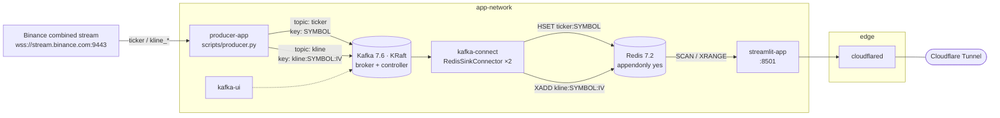

# fishtonks

Real-time crypto market pipeline: **Binance WebSocket → Kafka → Kafka Connect → Redis → Streamlit**.

A single producer subscribes to Binance's combined stream API, normalises every event into a flat
JSON record, and publishes to Kafka keyed by stream. Two Redis sink connectors drain those topics
into Redis (hashes for ticks, streams for candles). A Streamlit dashboard reads Redis only — it
never talks to Kafka — and is published through a Cloudflare Tunnel.



## Components

| Service | Image / build | Role |
| --- | --- | --- |
| `producer-app` | `producerdocker` (python:3.12-slim) | Binance WSS client → Kafka producer, auto-reconnect, graceful SIGTERM flush |
| `kafka` | `confluentinc/cp-kafka:7.6.0` | Single-node KRaft (combined broker+controller), 3 partitions, auto-create topics, RF=1 |
| `kafka-connect` | `connectdocker` (cp-kafka-connect 7.6.0 + `redis/redis-kafka-connect:0.9.1` + `connect-transforms:1.6.2`) | Distributed worker; connectors registered by the container command via REST |
| `redis` | `redis:7.2-alpine` | Materialised read model, AOF persistence, no auth |
| `streamlit-app` | `streamlitdocker` (python:3.12-slim) | Dashboard, bound to `127.0.0.1:8051` |
| `kafka-ui` | `provectuslabs/kafka-ui` | Topic browsing and connector status |
| `cloudflared` | `cloudflare/cloudflared:2026.10.0` | Egress-only tunnel publishing the dashboard |

`app-network` carries all internal traffic; `edge` connects `streamlit-app` to `cloudflared` so the
dashboard has no inbound port exposure beyond loopback.

## Data flow

1. `utils/streamloader.py` expands `configs/stream_config.json` (symbols × streams) into one
   combined-stream URL.
2. `producer.py` parses each event by stream suffix (`ticker` vs `kline_*`), flattens it, converts
   the ms timestamp to ISO-8601 UTC, and sends `json.dumps(record)` with a UTF-8 key.
3. Kafka topics are per event family: `ticker` and `kline` (intervals are **not** separate topics —
   the interval lives in the key).
4. Kafka Connect writes:
   * `ticker` → `HSET ticker:<SYMBOL>` (last-value cache, one hash per symbol);
   * `kline` → `XADD` to a stream named after the message key, via `ExtractTopic$$Key`, which
     rewrites the topic to `kline:<SYMBOL>:<INTERVAL>` and thereby selects the Redis stream key.
5. Streamlit discovers keys with `SCAN` and reads incrementally (`XRANGE` from the last seen entry
   ID, `XREVRANGE 600` on a cold/stale load).

### Record schemas

`ticker` (Redis hash, one field per column):

```json
{"symbol":"BTCUSDT","timestamp":"2026-11-01T12:00:00+00:00","bid_price":0.0,"bid_qty":0.0,
 "ask_price":0.0,"ask_qty":0.0,"last_price":0.0,"pct_change":0.0,"avg_price":0.0,
 "open_price":0.0,"high_price":0.0,"low_price":0.0}
```

`kline` (Redis stream entry; `timestamp` is the candle **open time**):

```json
{"symbol":"BTCUSDT","interval":"1m","timestamp":"2026-11-01T12:00:00+00:00",
 "open_price":0.0,"close_price":0.0,"high_price":0.0,"low_price":0.0}
```

### Redis key space

| Pattern | Type | Written by | Notes |
| --- | --- | --- | --- |
| `ticker:<SYMBOL>` | hash | `redis-hash-sink-connector` (`HSET`) | Overwritten every tick |
| `kline:<SYMBOL>:<INTERVAL>` | stream | `redis-stream-sink-connector` (`XADD`) | Append-only, grows without bound |

## Quick start (Docker Compose)

```bash
printf 'CF_TUNNEL_TOKEN=%s\n' '<token>' > .env     # unquoted, see note below
docker compose up -d --build
docker compose logs -f producer-app
```

Dashboard: <http://127.0.0.1:8051>. Kafka UI, Kafka, and Redis ports are commented out in
`compose.yaml`; publish them locally or reach them over `app-network`.

`compose.override.yaml` bind-mounts `scripts/`, `utils/`, and `configs/` into the app containers so
Python edits need no rebuild. To run exactly what the images contain:

```bash
docker compose -f compose.yaml up -d
```

### Verify the flow

```bash
docker compose exec redis redis-cli --scan --pattern 'ticker:*'
docker compose exec redis redis-cli XLEN kline:BTCUSDT:1m
docker compose exec redis redis-cli HGETALL ticker:BTCUSDT
curl -s localhost:8083/connectors   # connector registration
```

## Configuration

`configs/stream_config.json` — the fan-out: every symbol is crossed with every stream.

```json
{ "symbols": ["btcusdt", "ethusdt", "solusdt"], "streams": ["ticker", "kline_1s", "kline_1m", "kline_5m"] }
```

`configs/kafka.env` — producer settings (`BOOTSTRAP_SERVERS`, `CLIENT_ID`, `ACKS`, `LINGER_MS`,
`RETRIES`). `utils/configloader.py` lets a matching **environment variable win over the file**, which
is how the same file serves both `localhost:9092` on the host and `kafka:29092` inside containers.
Note that only the keys listed above are mapped into the `KafkaProducer`; anything else in the file
is inert.

Tunables worth knowing:

| Knob | Where | Effect |
| --- | --- | --- |
| `KAFKA_NUM_PARTITIONS` | `compose.yaml` | 3 per topic; caps parallelism per consumer group |
| `ping_interval` / `ping_timeout` / `reconnect` | `producer.py` | Keepalive + reconnect; without them a silent socket hangs `recv()` forever |
| `MAX_KLINE_POINTS` / `MAX_CANDLES` / `FULL_RELOAD_SECONDS` | `streamlit_app.py` | Chart window, candle count, periodic full reload |
| `REFRESH_MODES` | `streamlit_app.py` | 1s / 2s / 5s / 10s / off |

## Operations notes

* **Redis has no authentication** and the dashboard is internet-facing via the tunnel. Add Redis
  auth plus TLS before treating this as anything other than a demo.
* **Kafka replication factor is 1** everywhere (`offsets`, transaction log, Connect internal
  topics). A single broker is a single point of failure.
* **`kline:<SYMBOL>:<INTERVAL>` grows forever** — there is no `MAXLEN` on the `XADD`, no TTL, and no
  compaction. Redis memory tracks total candle history.
* **Connectors are registered by the container command in `compose.yaml`** with `curl` against the
  Connect REST API. That is a plain `POST`, so it creates the connectors once; editing a config and
  restarting does not update an existing connector — `PUT /connectors/<name>/config` does. Deleting
  the Connect volume re-registers them.

## Repository layout

```
compose.yaml / compose.override.yaml   Docker Compose stack (+ dev bind mounts)
producerdocker / streamlitdocker / connectdocker   per-service Dockerfiles
scripts/producer.py                    Binance WSS → Kafka
scripts/streamlit_app.py               Redis → Streamlit dashboard
utils/configloader.py                  kafka.env parser with env-var override
utils/streamloader.py                  symbols × streams → combined stream URL
configs/stream_config.json             symbols + stream subscriptions
configs/kafka.env                      producer settings
```
